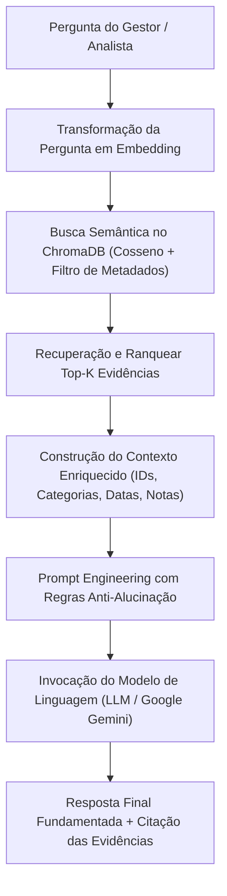

# Tech Challenge 04 - Voice of Customer Intelligence com RAG

Solução desenvolvida para o **Tech Challenge da Fase 4 - AI Scientist (Pós-Tech FIAP)**.  
O objetivo deste projeto é construir uma solução completa de **Voice of Customer (VoC) Intelligence baseada em Retrieval-Augmented Generation (RAG)**, permitindo a exploração inteligente e fundamentada em dados das avaliações de clientes do **Brazilian E-Commerce Public Dataset by Olist**.

---

## 📌 Visão Geral do Problema de Negócio
Empresas de e-commerce recebem diariamente milhares de avaliações textuais contendo queixas, elogios, frustrações e expectativas. Embora indicadores quantitativos (como notas de 1 a 5 estrelas) indiquem o termômetro geral da operação, grande parte dos insights críticos reside nos **dados não estruturados** (comentários em texto).

Analisar manualmente mais de 40 mil comentários é uma tarefa demorada e pouco escalável. Este projeto implementa um sistema que transforma esse acervo em uma **base de conhecimento inteligente**, permitindo que analistas e gestores façam perguntas em linguagem natural e recebam **respostas fundamentadas com evidências rastreáveis**.

---

## 🏗️ Arquitetura da Solução

O fluxo de funcionamento do sistema foi desenhado em camadas rigorosas de NLP e IA Generativa:



---

## 📂 Estrutura do Repositório

Seguindo o padrão de modularidade e engenharia das fases anteriores (`tech-challenge-01`, `tech-challenge-02` e `tech-challenge-03`):

```text
tech-challenge-fase4/
├── data/
│   ├── olist_*.csv                      # Datasets relacionais brutos do Olist
│   ├── processed/
│   │   └── reviews_enriched_for_rag.csv # Base de conhecimento tratada e enriquecida
│   └── vector_db/                       # Banco de Dados Vetorial persistido (ChromaDB)
├── notebooks/
│   ├── 01_exploracao_corpus_nlp.ipynb   # Aula 01: Estatísticas do corpus, Zipf e níveis linguísticos
│   ├── 02_pipeline_preprocessamento.ipynb # Aula 02: Limpeza, contrações PT-BR, RSLP e stop words
│   ├── 03_vetorizacao_tfidf_baseline.ipynb# Aula 03: BoW, N-grams, TF-IDF e Baseline de ML
│   ├── 04_banco_vetorial_chroma.ipynb   # Embeddings, indexação e busca vetorial por cosseno
│   └── 05_pipeline_rag_llm.ipynb        # RAG Completo: Contexto, LLM, evidências e tratamento de nulos
├── src/
│   ├── __init__.py
│   ├── preprocessing.py                 # Pipeline modular e idempotente de pré-processamento
│   ├── vectorization.py                 # Vetorizadores BoW/TF-IDF, esparsidade e termos discriminativos
│   └── rag_pipeline.py                  # Classe orquestradora do RAG para consultas
├── docs/
│   └── 01_engenharia_de_dados.md        # Documento formal com a defesa de todas as decisões técnicas
├── requirements.txt                     # Dependências do projeto
├── .gitignore                           # Proteção contra envio de arquivos pesados
└── README.md
```

---

## 🔬 Trilha dos Notebooks de Estudo e Desenvolvimento

A solução está dividida em 5 notebooks sequenciais e reproduzíveis, fundamentados na ementa da Fase 4:

1. **[`01_exploracao_corpus_nlp.ipynb`](notebooks/01_exploracao_corpus_nlp.ipynb) (Fase 4 | Aula 01):**
   - Diagnóstico dos dados brutos: constatação de que 58% das avaliações não possuem texto (apenas notas numéricas).
   - Estatísticas de corpus: contagem de tokens ($N$), vocabulário ($|V|$) e Type-Token Ratio (TTR).
   - Demonstração empírica da **Lei de Zipf** em gráfico log-log.
   - Análise dos quatro níveis linguísticos (morfologia, sintaxe, semântica e pragmática/ironia).

2. **[`02_pipeline_preprocessamento.ipynb`](notebooks/02_pipeline_preprocessamento.ipynb) (Fase 4 | Aula 02):**
   - Limpeza estruturada com regex (remoção de HTML e URLs).
   - Dicionário de expansão de contrações informais de PT-BR (`CONTRACTIONS`: *\"vc\"*, *\"pq\"*, *\"tbm\"*, *\"obg\"*, *\"n\"*).
   - **Salvaguarda de Stop Words:** preservação mandatória de palavras de negação (*\"não\"*, *\"nunca\"*, *\"sem\"*) para não inverter o sentimento da avaliação.
   - Teste de Stemming com algoritmo **RSLP** (específico para língua portuguesa).
   - Enriquecimento relacional com pedidos e categorias de produtos (`reviews_enriched_for_rag.csv`).

3. **[`03_vetorizacao_tfidf_baseline.ipynb`](notebooks/03_vetorizacao_tfidf_baseline.ipynb) (Fase 4 | Aula 03):**
   - Implementação de Bag of Words (BoW) e mensuração de esparsidade (> 99%).
   - N-grams (1, 2) para capturar contexto local (*\"não recebi\"*, *\"veio quebrado\"*).
   - TF-IDF com escala sublinear e extração das top features discriminativas por polaridade.
   - Baseline supervisionado clássico de Machine Learning (Regressão Logística com validação cruzada 5-fold e métrica F1).

4. **[`04_banco_vetorial_chroma.ipynb`](notebooks/04_banco_vetorial_chroma.ipynb):**
   - Inicialização do **ChromaDB** persistido localmente.
   - Indexação em lotes dos documentos vetoriais densos via `DefaultEmbeddingFunction()`.
   - Implementação do **Desafio Adicional: Metadata Filtering** na busca por cosseno.

5. **[`05_pipeline_rag_llm.ipynb`](notebooks/05_pipeline_rag_llm.ipynb):**
   - Orquestração do pipeline completo com LangChain.
   - Engenharia de Prompts rígida com regras anti-alucinação.
   - Execução dos cenários de teste exigidos no edital:
     - Investigação de reclamações de entrega.
     - Busca por experiências positivas e elogios.
     - Teste de pergunta fora de escopo (garantindo que o sistema reconhece suas limitações).

---

## ⚙️ Instalação e Execução

### 1. Criar e Ativar Ambiente Virtual
```bash
python -m venv venv

# No Windows:
.\venv\Scripts\activate

# No Linux/Mac:
source venv/bin/activate
```

### 2. Instalar as Dependências
```bash
pip install -r requirements.txt
```

### 3. Configurar Variáveis de Ambiente
Crie um arquivo `.env` dentro da pasta `tech-challenge-fase4/`:
```env
GOOGLE_API_KEY="SUA_CHAVE_DO_GOOGLE_GEMINI"
```
*(Caso não possua chave, a execução dos notebooks 01 a 04 funciona 100% offline. O notebook 05 conta com simulação de montagem de prompt caso a chave não seja informada).*

### 4. Executar os Notebooks
Abra o Jupyter e execute os notebooks na ordem numérica:
```bash
jupyter notebook notebooks/
```

---

## 🎯 Requisitos e Critérios Atendidos

| Requisito do Edital | Como foi Atendido | Onde Encontrar |
| :--- | :--- | :--- |
| **Seleção dos dados** | Junção relacional de reviews, pedidos, itens e produtos para criar documentos contextualizados. | `notebooks/02_pipeline_preprocessamento.ipynb` |
| **Limpeza e preparação** | Regex modular, expansão de contrações informais de PT-BR e preservação de negações. | `src/preprocessing.py` |
| **Tratamento de ausentes** | Exclusão justificada de reviews sem texto (58%) e preenchimento de categorias nulas com "desconhecida". | `notebooks/01_exploracao_corpus_nlp.ipynb` |
| **Organização dos documentos** | Concatenação estruturada de categoria, nota, data e comentário em um formato rico. | `src/preprocessing.py` |
| **Criação dos embeddings** | Embeddings densos via MiniLM sem custo de nuvem e métrica de distância por cosseno. | `notebooks/04_banco_vetorial_chroma.ipynb` |
| **Armazenamento e indexação** | Banco vetorial ChromaDB com persistência em disco e metadados indexados. | `data/vector_db/` |
| **Respostas fundamentadas** | Prompt com injeção obrigatória de fontes e IDs das evidências recuperadas. | `notebooks/05_pipeline_rag_llm.ipynb` |
| **Prevenção de alucinações** | Tratamento explícito de recusa quando as evidências recuperadas forem insuficientes. | `src/rag_pipeline.py` |
| **Desafio Adicional** | Exploração contextual e filtros de metadados (`review_score`, `data`, `categoria`). | `notebooks/04_banco_vetorial_chroma.ipynb` |

---

## 👥 Equipe
Projeto desenvolvido para a Pós-Tech em Artificial Intelligence for Software Engineers (FIAP).
